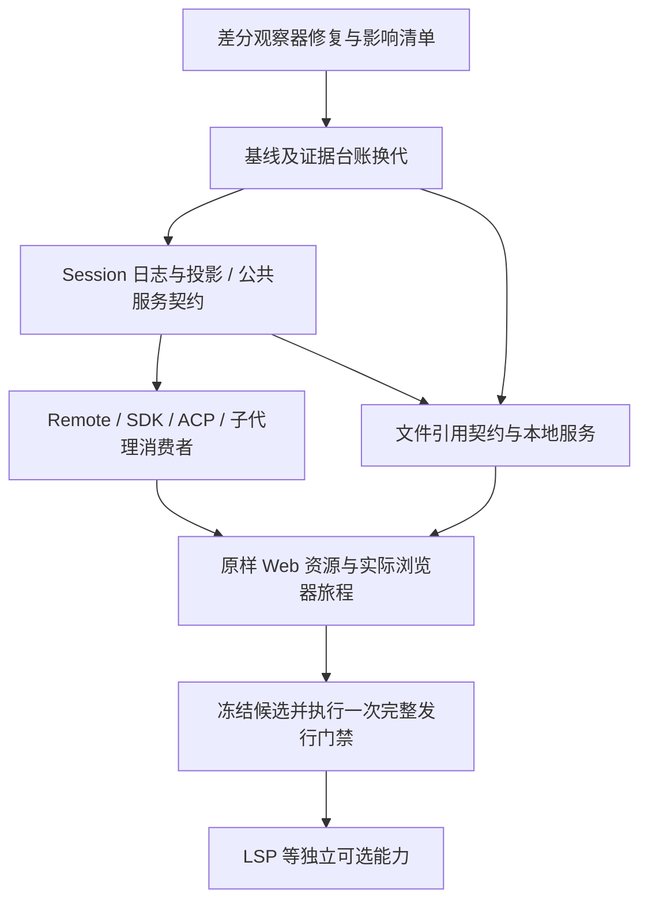

# dsh-v0.1.2-rc.1 基线推进与功能缺口行动评估

日期：2026-10-14。性质：行动方案与只读源码评估；未切换基线、未实施功能迁移、未签发新发行资格。

## 1. 建议决策

采用 `dsh-v0.1.2-rc.1`，目标提交固定为 `a66e4702047846cdaa10c66c9d3df3951f5ea70d`。本轮目标是完成该固定版本的增量契约迁移，并优先补齐 `@` 文件引用；LSP 等独立能力先做可行性验证，作为后续可选扩展。

这一步有明确的产品收益：官方新增完整会话轮次导航与摘要预览、深历史加载及跳转，并改善流式聊天更新、滚动和代码块呈现。它同时包含跨模块重构，工作量应评为中等至偏高，具体估算在差分归属与契约拆分后给出。RC 名称或同属 0.1.2 不能证明迁移低风险。

上游基线、Python 产品版本和发行资格分别记录。选择上游 `rc.1` 不自动决定本产品下一个版本号，也不把现有 `v0.1.1` 的验收变成新候选验收。

## 2. 对已有两份报告的校正

输入报告：[基线选型](2026-10-14-upstream-baseline-iteration-assessment.md)、[文件引用与缺失包](2026-10-14-web-file-reference-and-unmigrated-packages-report.md)。以下为本次核对结论，保留原报告作为历史评估。

| 原报告判断 | 本次观察与行动影响 |
|---|---|
| 当前 alpha.1 已完全 1:1 对齐 | `migration/baseline.json` 的 `accepted_upstream` 为 null；生成状态也写明尚未确立。完整发行门禁证明其绑定的有限合同与发行旅程，不能扩展为所有包已经对齐。 |
| rc.1 包结构不变、主要是低风险补丁 | 实际有 656 个提交、3,732 个变更文件，含 67,313 行增加、44,202 行删除；完整 manifest 从 272 到 274，有新增、删除及职责迁移。总数包含文档、测试与 Agent Notes，不能直接换算实现工时。 |
| 上游共 50 个包，或当前 254 个包中 163 已迁移、91 缺失 | 这几个数字没有统一计数口径。当前正式清单是 272 个 manifest：201 runtime、48 frontend、9 tooling、7 fixture、6 platform、1 example。registry 行、内聚接口和前端编译子包都不能直接当成完成数。 |
| 文件引用两个包在状态表里 unstarted | 当前台账有 86 个 integrated 任务，未给出这两个包的独立 unstarted 行；其 manifest 的 parity 是 `not-certified-by-inventory`。应新增可验收的能力任务，而不是沿用报告中的状态断言。 |
| LSP 提供高级代码补全 | rc.1 的 `tool-lsp` 是供模型使用的只读定义、引用、实现及 hover 导航工具，不等同于 Web 编辑器自动补全。 |
| E2B 与 POSIX 都是平台互斥项 | POSIX 专属能力需要平台替代；E2B 是可选云服务，是否引入取决于产品范围、依赖和凭据，不是天然与 Win7 互斥。 |

当前产品工作树评估提交：`38e650cf56d0c8a9d423057cf2c044055aa4a143`。评估开始时产品和 `reference` 均无本地改动；`reference` 仍固定在 `cd5ef8148158c3a752a658978873241fdf8e2bbc`。

## 3. rc.1 的实质变化

按 Git 路径而非包名计数，新增六个 manifest、删除四个；其中 Python code-runtime 是旧路径/名称向 experimental 的迁移，不能算作两项独立能力。

| 类型 | 包/变化 | 必须处理的影响 |
|---|---|---|
| 新增 | `dsh-session-turn-outline` | 提供完整会话轮次摘要投影，支撑新客户端导航；需同时迁移投影、Remote 输出和冷历史消费者。 |
| 新增 | `dsh-client-ui-schedule` | 核对实际 Web 配置、host half、client manifest 和声明的浏览器 bundle；不因新增一个 manifest 就固定增加一个客户端行。 |
| 新增 | `dsh-deque`、`dsh-util-time`、`dsh-util-values` | 审查公共值语义及消费者。Python 可以内聚实现，仍须提供等价行为证据。 |
| 迁移 | `dsh-code-runtime-python` → `dsh-experimental-code-runtime-python` | 更新名称、默认组合和测试范围；不能沿用旧包名制造 canonical 激活成功。 |
| 删除 | `dsh-session-persistence-sqlite` | 新 canonical 路径按 rc.1 的 JSONL 组合推进，另行设计现有 SQLite 数据的保留/导出兼容路径。 |
| 删除 | `dsh-agent-spine-demo`、`dsh-tool-subagent-report` | 清理当前生产组合及接受路径里的过时引用；新的集成旅程使用真实 profile，子代理消息按新的 steer/相邻投递语义核对。 |
| 跨模块变化 | 区分 `SessionSeq` 与 `SessionLogOffset` | 不能只改类型名；核对日志读取、快照、投影、分页、恢复、SDK/ACP/Remote 的游标语义。上游提交 `27bf1039db` 涉及 351 个文件。 |
| 跨模块变化 | Remote failure vocabulary、公共值转为 service API、projection 注册要求 | 先明确提供端与消费者的共同义务，再修改 Python，避免各包各自兼容。 |
| Web 体验变化 | 轮次轨道、`loadThrough`、跳转定位、流式节流和延迟渲染 | 导入原样前端的同时补齐 host 输出，验证长会话、冷恢复、流式和滚动旅程。 |

有关 SQLite 的上游提交 `4553c9d957` 是后端删除，不是报告所述的 SQLite 恢复补丁。删除上游实现不等于可以删除用户会话数据。本轮应先定义旧数据的可读取性、导出方式、失败恢复和回退规则，再决定兼容插件何时退役。

## 4. 行动路径与依赖



`@` 文件引用的语法、排序与源码场景梳理可以从第一阶段开始；它的正式验收等待服务/Agent 所有权及新版系统提示词接口稳定。这样可以先明确用户缺口，又避免基线切换后重复改写提供端。

以下编号是建议行动项，不是已经登记或领取的 migration task。

| 行动项 | 优先级 / 前置依赖 | 交付与退出条件 |
|---|---|---|
| A01 差分观察与能力分类 | P0，最先 | 修复重命名状态解析；重新执行正式差分观察。按提供端、必要消费者、测试和动态契约归属生成 rc.1 影响表，并复核重命名两端及新增包依赖。 |
| A02 基线和证据换代 | P0，A01 | 保留 alpha.1 历史；协调冻结切换，更新 reference pin、baseline、modules、test/dynamic inventory、contracts、mappings、tasks 与 Source 输入。结构校验通过，旧证据不会满足新目标。 |
| A03 Session 与持久化迁移 | P0，A02 | 完成 seq/offset、索引读取、快照、projection/cache、冷恢复和轮次摘要；明确 SQLite 旧数据策略。通过 Source/Python 配对和直接消费者回归。 |
| A04 公共服务与调用消费者 | P0，A02/A03 的相关提供端 | 覆盖 systemPrompt 区段顺序接口、公共值 service API、Remote 错误词汇、steer/图片跟进、SDK/ACP 游标与归属；每个共享接口变更同时提交必要消费者。 |
| A05 文件引用完整能力 | P0，A03/A04 的 Agent 与提示词接口 | 服务 `(agent, query, signal)`、多工作区、异步有界索引、取消、失效和卸载闭包；canonical Web 真实输入 `@` 能列出候选且正文不自动注入。 |
| A06 官方 Web 导入与集成 | P0，A03–A05 的必要输出 | 固定 rc.1 依赖和构建输入，导入原样 TSX/CSS 产物；按有效 Loader/manifest 派生模块。轮次跳转、长历史、引用、流式、设置/计划任务相关旅程通过。 |
| A07 缺口审计与可选能力样机 | P1，可先审计，样机依赖稳定接口 | 对目标全部 manifest 建立能力/证据矩阵；LSP 做 Win7/Py3.8 依赖与真实 stdio 样机。默认不加入首批发行阻塞项；若目标 profile 直接依赖某缺口，则提升为 P0。 |
| A08 稳定候选统一资格 | P0，A01–A06 完成 | 冻结干净候选、Source 输入、依赖和浏览器；对本次新候选执行 `verify_release.py`，发布使用该回执绑定的实际 ZIP。 |

## 5. 文件引用专项验收

已确认的静态断裂：`SessionFileReferences.list()` await 调用 `fileReferences.list(agent, query, signal)`；当前注册的 `WorkspaceFileSearch.list(raw_query, signal)` 是同步方法，参数和返回值均不匹配。现有插件还以加载时 cwd 建立单实例，且修改用户消息并内联文件内容。上述问题足以说明实现不兼容，但本次没有执行浏览器旅程，不将其宣称为已复现的完整 Web 根因。

不能只增加一个参数或去掉 `await`。A05 必须包含以下范围：

- 抽象服务与本地提供方职责明确，基于 Agent 身份缓存，使用该会话 `header.cwd`，按上游要求处理缺省值；验证 preset 隔离、动态服务可见性及 Remote 控制器激活。
- `list` 提供 awaitable、传递取消、避免大目录扫描阻塞 Web 事件循环；对并发构建、缓存失效和 disposal 给出可验证的所有权与等待规则。
- 对齐默认 20 条结果、50,000 条索引和完整 excludedDirectories，目录下钻、模糊排序、隐藏路径、空格/引号、中文及 Windows 路径语义。
- 按上游场景核对绝对路径、父级路径、盘符及链接的行为，不能只依据 `relpath.startswith('..')` 推断正确。
- 通过 `session/event` 的 `tool/result` 等上游规定的入口使索引失效；Agent 释放及插件卸载清理索引、prompt fiber 和在途任务。
- 使用新版 `systemPrompt.getSectionOrder('FILE_REFERENCE')` 所对应的服务接口；仅在上游指定的 read 工具可见条件下安装指引。需确认本项目 `str_replace_editor` 与 read 能力的实际组合，不能无条件注入。
- 用户选择候选只插入 mention，目录以 `/` 结束，文件正文通过模型工具读取。模型可见输入必须满足现有日志可重建规则。
- 替换 `tests/test_context_injections.py` 中要求内联全文的旧断言；增加提供端、Remote、真实 profile 双工作区和浏览器端的有效用例。保留前端发现失败返回空候选的上游语义，在服务日志/配对观察中定位失败。

至少验证空查询、目录下钻、空格/中文、两个不同 cwd、文件变动后刷新、取消和卸载、正文不自动进入请求、会话引用候选与文件候选并存。原样前端和真实 `/api/remote.mux` 是验收链路的一部分。

## 6. 其他缺失能力的取舍

| 能力 | 建议顺序 | 原因与范围 |
|---|---|---|
| LSP 三包 | P1，独立批次 | 对代码导航有价值；先做 service → stdio provider → tool 闭包。验证 UTF-16 坐标、URI/Windows 路径、取消/超时、进程退出/回收、不可用服务器和有界输出。语言服务器可选安装，不让普通 Portable 启动强依赖 Node 或 Python 3.9+。 |
| `subagent-dsh-sdk` | P1/P2，按当前实际覆盖决定 | 本产品自己的 SDK 是较相关扩展；先核对现有 ACP/SDK 子代理是否已经覆盖该职责，避免重复实现。外部 Codex/Claude CLI 的支持另行评估。 |
| Exa、Perplexity 搜索 | P2，可选 provider | 挂到既有 web 服务，不默认加载；明确凭据、网络、错误/取消和真实 provider 证据。mock 通过只能证明本地协议。 |
| Webhook / GitHub ingress | P2，独立批次 | 与任务唤醒、凭据和网络入口有关，先明确产品需求及生命周期；不加入此次 Web 文件引用闭包。 |
| 外部 CLI hooks / 子代理 | P2/P3 | 协议可实现不代表对应 CLI 能在 Win7 运行；支持范围必须绑定具体依赖和实测环境。 |
| E2B、agent-team、inspector、webworker 原型 | 延后 | 依赖或产品范围较大；按 rc.1 实际默认组合判断是否需要，仅“未挂载”不能形成迁移义务。 |
| POSIX 专属能力 | 平台替代 | Windows 保留 PowerShell/cmd 路径；如继续承诺 POSIX 支持，Bash 能力仍需单独维护，不能全项目删除。 |
| 纯接口、公共微包、前端编译子包、tooling | 逐项映射 | 允许 Python 内聚或构建期实现，但记录实际提供端/消费端、证据和未覆盖范围；不以“无需独立挂载”自动判完成。 |

能力矩阵至少包含：目标 manifest、角色分类、目标 profile 是否可达、Python 实现/服务、client bundle、现有证据范围、缺口、平台适配、优先级和行动项。需要覆盖新目标的全部 manifest，而非沿用“91 个未迁移包”作为固定待办。

## 7. 验证与证据迁移

基线切换是一次有依赖的台账变更。`migration.py` 要求 reference HEAD、目标 SHA、manifest 哈希、活动契约/任务/mapping/inventory 相互一致；`migration_inventory.py` 在 manifest 集合漂移时会拒绝重建。因此不能只改 `baseline.json` 后立即运行生成器，也不能批量把旧证据改写成 rc.1。

除 migration 文件外，旧 pin 还出现在 `scripts/frontend-inputs.json`、多个 oracle/probe、frozen Source observations、Cordis inspect/contract catalog、JavaScript workflow provenance 等位置。逐项区分历史证据和当前可执行输入：历史原样保留，当前输入重新绑定或重新构建；避免全仓库替换 SHA。上游 bug 九项例外逐项确认新目标是否仍有相同失败签名，已经修复的差异应撤销当前适用性。

| 阶段 | 验证范围 | 证明边界 |
|---|---|---|
| 评估/方案文档 | Git 差分、manifest、源码链路、文档链接/差异 | 不证明新功能运行或 Win7 认证。 |
| A01 观察器修复 | `test_upstream_delta` 与真实 alpha.1 → rc.1 差分；含三位补零相似度、路径 NUL 身份和两端 owner | 证明观察器可处理本次输入，不证明业务对齐。 |
| A02 台账换代 | migration workflow、inventory、证据失效/保留、checkout/pin 及结构校验 | 证明新迁移目标和记录一致。 |
| A03/A04 | Source 原样断言、Source/native 配对、Session/恢复、projection/cache、SDK/ACP/Remote 直接消费者 | 证明实际验收的子合同，不扩展到全部任务。 |
| A05/A06 | 引用 provider/Remote/完整 profile 与原样浏览器；长历史跳转、冷恢复、流式/滚动；现代浏览器及固定 Chromium108 | 证明这些输入与浏览器的旅程；Chromium108 不能代替 Win7 真机。 |
| A08 | `scripts/verify_release.py` 的完整 Python、固定 Source、配对与实际解压 Portable/browser | 只认证回执绑定的候选、冻结输入和 ZIP。 |

每个实现阶段先说明原失败用例、提供端及必要消费者的定向范围。全部相关定向检查稳定后安排一次完整门禁，不提前重复跑全量 pytest，也不为每个修复构建 Portable。全门禁失败保留诊断，修复后先复验对应场景，再在下个稳定候选安排完整签收。

Win7 真机、Win7 浏览器和真实云 provider 仍是独立证据要求；当前延期状态不会因为升级 RC 自动解除。本次不能沿用原报告中“100% 兼容/绝对稳定”的表述。

## 8. 本次观察与前置阻断

只读差分命令：

```powershell
.venv/Scripts/python.exe scripts/upstream_delta.py --base cd5ef8148158c3a752a658978873241fdf8e2bbc --target a66e4702047846cdaa10c66c9d3df3951f5ea70d --output .goose/out/rc1-assessment-20261014-38e650cf/upstream-delta.json
```

结果：退出码 1，`ValueError: Git change status is unsupported`。Git 输出有 `R066`、`R092` 等三位补零重命名相似度；当前 parser 仅支持一到两位数字或特例 `100`。这是 A01 的明确修复对象，不应关闭严格解析或取消路径身份检查。

独立只读观察保存于 `.goose/out/rc1-assessment-20261014-38e650cf/assessment.json`，含两端 manifest 内容及逐项 Git 变化；原始 NUL 输出为 `git-name-status.z`，失败摘要为 `upstream-delta-failure.txt`。该观察用于方案核算，不冒充正式差分脚本回执或迁移 acceptance。manifest 按两端 Git tree 的全部 `package.json` 计数；变化按 `--find-renames` 的最终路径/状态计数。

当前 alpha.1 台账的 `migration.py check` 退出码 0，确认记录与固定 inventory 一致；`migration.py ready` 退出码 0、输出为空，当前没有可领取的 ready 任务。两者只是当前记录检查，不代表 rc.1 已准备或业务已对齐。结果另存本次观察目录的 `verification.json`。方案文档的两个相对链接、数字与观察一致性、末尾换行及空白检查通过；本次未执行 pytest。

尚未创建 rc.1 migration task、修改 target/accepted 状态、切换 reference 或执行发行门禁。

建议首批范围固定为 A01–A06 与 A08；A07 的缺口审计贯穿首批，LSP 等实现保持独立。只有经目标 profile 可达性或共享契约证明属于直接依赖的缺口，才加入首批阻塞清单。
