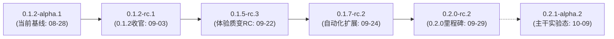
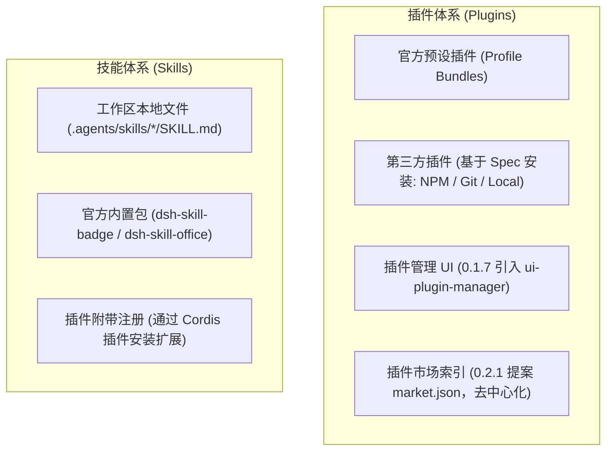

# 原版 DeepSeek Harness 升级基线评估与选型调研报告

**日期**：2026-10-14  
**作者**：Antigravity Agent  
**状态**：已完成（已归档入 `docs/research/`）  
**当前对齐基线**：`dsh-v0.1.2-alpha.1`（Commit: `cd5ef8148158c3a752a658978873241fdf8e2bbc`）  
**当前产品发布状态**：`v0.1.1` 单次完整 CI 门禁通过（10,564 passed / 2 skipped / 83 配对），已发布 Portable 候选  

---

## 1. 背景与调研目标

本项目（`deepseek-harness-win7`）的核心目标是维护一个轻量、高扩展性、**兼容 Windows 7 SP1** 与 **Python 3.8.10** 的官方 DeepSeek Harness Cordis 架构实现，并提供零依赖的 Portable 发行包。

在前期阶段，项目已完全达成与原版 `dsh-v0.1.2-alpha.1` 基线的 1:1 契约对齐，且已完成 `v0.1.1` 的产品级交付。为了推进下一阶段的产品演进，本次调研针对官方仓库（`reference` / `deepseek-ai/deepseek-harness`）中后续发布的所有 Tag、Release 及主干提交展开深度评估，回答以下核心问题：
1. 原版官方发布了哪些 Tag 与 Release，其演进脉络与技术边界是什么？
2. 哪个版本是兼顾“**功能价值**”、“**版本稳定性**”与“**Windows 7 / Python 3.8 兼容性**”的最佳对齐迁移基线？
3. 官方的 **Desktop App（桌面端）** 是在哪个版本引入的？对本项目的架构策略有何影响？
4. 原版是否有 **插件市场** 和 **Skill 市场**？其分发与管理机制具体是如何运转的？

---

## 2. 原版版本全景与演进脉络

原版官方仓库截至 2026-10-14 共记录了 27 个正式 Tag，命名均遵循 `dsh-vX.Y.Z-(alpha|rc).N` 规范。版本演进可划分为五个明显的阶段：

### 全量核心候选 Tag 对比矩阵

| 候选基线 Tag | 发布日期 | 距当前基线 Commits 差 | 稳定性定性 | 核心变化与产品增益 | 迁移难度与 Win7/Py3.8 风险 | 选型推荐指数 |
|---|---|---|---|---|---|:---:|
| **`dsh-v0.1.2-rc.1`** | 2026-09-03 | +656 | **极高** (0.1.2 最终RC) | 主要是 191 项 bug 修复与会话持久化/Cordis 边界完善；包结构无新增 | **极低**。架构 100% 连续，本质相当于给当前版本打官方补丁 | ⭐⭐⭐ (仅做保守维护) |
| **`dsh-v0.1.5-rc.3`** | 2026-09-22 | +2,149 | **高** (0.1.5 最终RC) | **大幅提升 Web GUI 与体验**： 1. 聊天区 Mermaid/Graphviz/SVG 流程图原生渲染； 2. 右侧 Dockkit 多面板、侧边栏文件树与文档预览； 3. 官方模型目录纳入 DeepSeek V4 / V41 Flash | **中等**。Cordis 核心、Connection/Remote 协议与包清单（50个）保持高度一致；无 OS 层破坏性依赖，完美契合 Win7 SP1 与 Python 3.8 | **⭐⭐⭐⭐⭐ (最佳渐进迭代基线 - 首选推荐)** |
| **`dsh-v0.1.7-rc.2`** | 2026-09-24 | +5,796 | **中高** (0.1.7 最终RC) | 引入 `browser-use`、`computer-use`、`ptc-runtime`、`ssh`；重写了 Remote uplink 与 Peer 连接通道；全套 Settings 面板 | **高**。Connection 协议大改，引入的桌面/浏览器自动化在 Win7 上存在较多底层调用摩擦 | ⭐⭐ (不建议作为过渡) |
| **`dsh-v0.2.0-rc.2`** | 2026-09-29 | +6,244 | **高** (0.2.0 阶段里程碑) | **0.2.0 正式里程碑**：整合 0.1.6~0.1.7 的全部能力，新增 `telemetry` (OTel)、Schedule 任务行细粒度管理、全局设置体系完善 | **高**。属于跨大版本跃迁，改动量巨大。需逐项评估并隔离 Win7 下桌面/自动化工具边界 | **⭐⭐⭐⭐ (跨大版本跃迁候选)** |
| **`dsh-v0.2.1-alpha.2`** | 2026-10-09 | +7,179 | **低** (Alpha 实验态) | 处于高频重构中（分类可选插件、删除 hooks/webhook/runtime-diagnostics、升级 pnpm 11.28.5、重构 pi-ai） | **极高**。上游接口持续变动，违反项目“固定成熟版本批次持续对齐”原则 | ❌ (强烈不推荐) |

---

## 3. 各阶段技术差异与选型分析

### 3.1 候选一：`dsh-v0.1.2-rc.1`（保守修复，收益过小）
- **变更规模**：+656 commits（feat: 32, fix: 191, refactor: 32）。
- **技术特征**：包结构完全没变（50个包）。核心是解决 0.1.2-alpha.1 在 SQLite 恢复、Fiber 异步析构、WebSocket 关闭竞争等方面的边缘异常。
- **评价**：迁移阻力极小，但缺乏用户直观可见的功能提升，无法支撑有实质意义的“版本迭代”。

### 3.2 候选二：`dsh-v0.1.5-rc.3`（⭐ 强烈推荐的首选基线）
- **变更规模**：相比当前基线 +2,149 commits（feat: 221, fix: 588）。
- **技术特征**：
  1. **稳定性极佳**：经过 `0.1.5-alpha.1`、`alpha.2`、`rc.1`、`rc.2`、`rc.3` 多轮迭代修复，是 0.1.5 系列的最终稳定收官 RC。
  2. **Web GUI 表现力大幅跃升**：
     - Markdown 代码块增加对 **Mermaid**、**Graphviz**、**SVG** 和 **HTML** 的原生高保真预览，并跟随浅色/深色主题动态适配。
     - 引入侧边栏文件树（`ui-sidebar-files`）、文档实时预览（`ui-sidebar-documentpreview`）以及 Dockkit 多窗口管理（`ui-dockkit`、`ui-sidebar-right`）。
     - 工件卡片（Artifact Cards）具备原生文件动作（打开、另存、导航）。
  3. **模型生态升级**：
     - 模型目录正式引入 DeepSeek V4 与 DeepSeek V41 Flash，并优化了推理过程的折叠/展开动画。
  4. **Win7 / Python 3.8 兼容性完好**：
     - Cordis 核心（`packages/core`）与 Web 传输（`packages/host/webserver`）依然维持保守架构，**完全没有引入现代操作系统专有的原生自动化 API**，可 100% 保持在 Win7 SP1 和 Python 3.8.10 下健康运行。
- **评价**：**产出价值与迁移成本的最佳平衡点**，推荐作为下一步版本迭代的正式对齐基线。

### 3.3 候选三：`dsh-v0.2.0-rc.2`（大版本跃迁的次选里程碑）
- **变更规模**：相比当前基线 +6,244 commits。
- **技术特征**：
  - 正式跨入 0.2.0 时代。
  - 引入了完整的 Settings 设置中心、OpenTelemetry 遥测架构（`telemetry`）、更成熟的 Schedule 计划任务控制。
  - 但同时合入了 `browser-use`、`computer-use`、`ptc-runtime` 等涉及屏幕控制、复杂浏览器自动化的工具。
- **评价**：如果团队决定直接启动一次类似此前全量战役的大版本跃迁，0.2.0-rc.2 是最规范的候选基线；但其工作量较大，且需要针对 Win7 对桌面自动化工具做专门的降级与隔离。

### 3.4 排除 `dsh-v0.2.1-alpha.2` / `master`
- 截至 2026-10-09，上游主干正在进行大规模破坏性重构（例如 `refactor(experimental)!: classify optional packages and move prototypes`，移除了 `hooks`、`webhook`、`runtime-diagnostics`，升级了 `pnpm 11.28.5`）。
- 盲目跟进未定型的 Alpha 分支会导致对齐目标持续漂移。

---

## 4. 专项调研结论

### 4.1 Desktop App（桌面客户端）何时引入？
- **引入版本**：**`dsh-v0.1.5-alpha.1`**（发布于 **2026-09-08**）。
- **具体提交**：PR #3413（`ba05b7d49d`，*`feat(desktop): add managed Electron distribution`*），紧随 `dsh-v0.1.3-alpha.2` 之后合入主干。
- **代码结构**：
  - `apps/desktop` (`@deepseek-ai/dsh-desktop`)：基于 **Electron 44+** 的客户端外壳，负责多平台应用打包（NSIS / DMG）、托盘、菜单与系统升级。
  - `apps/desktop-host` (`@deepseek-ai/dsh-desktop-host`)：Electron 配套的私有 Node 宿主。
- **对本项目的启示**：
  - Electron 44 最低要求 Windows 10+，原生在 Windows 7 上不可运行。
  - 本项目（`deepseek-harness-win7`）采用 **Python 3.8 宿主 + 官方 React 18 Web GUI (`apps/web`) + 便携启动脚本 (`dsh-web.bat`)**，架构上完全不需要搬迁 `apps/desktop`，两者互不干扰。

### 4.2 插件市场与 Skill 市场的真相与分发机制
原版官方在这两个机制上的实际架构如下：

#### A. 插件市场（Plugin Market）
1. **原版至今不存在官方中心化插件市场**：官方不运营像 VS Code Marketplace 那样的中心托管商城。
2. **插件管理 UI（`ui-plugin-manager`）** 于 **`dsh-v0.1.7-rc.1`** 首次进入 Web 侧边栏，支持用户查看已装插件、切换启停与调整配置。
3. **第三方安装模式**：用户在界面中手动提供 Spec（NPM 包名、Git URL、本地路径），底层通过 `pnpm add` 完成依赖隔离安装。
4. **市场索引规范（Market Index）**：官方在 2026-10-02 提出提案，计划采用去中心化的静态 JSON 规范让社区自行发布索引，并在 0.2.1-alpha.2 制作了实验性 Catalog 浏览页。

#### B. Skill 市场（Skill Market）
1. **原版从未有过“Skill 市场”这一独立机制**。
2. **Skill 的定位是渐进式指令集（Progressive Disclosure Instructions）**：遵循标准的 Markdown 文档规范。
3. **分发渠道**：
   - 本地目录即插即用（`.agents/skills/`、`~/.config/dsh/skills/`）；
   - 或者作为 Cordis 插件的子模块通过上述插件渠道统一分发。

---

## 5. 最终推荐与后续推进路线

### 推荐选型：更新基线至 **`dsh-v0.1.5-rc.3`**
- **目标 Commit**：`a4c74a91e06b00fe0b0937bde982170c526cc842`
- **核心收益**：
  1. 完整获得官方成熟的 Mermaid / SVG 图表渲染能力与侧边栏文档/文件树预览；
  2. 官方原生支持 DeepSeek V4 / V41 Flash 模型目录；
  3. 避开 `0.1.7` 及后续版本引入的复杂桌面自动化与底层连接重构风险，确保 Windows 7 SP1 与 Python 3.8.10 绝对稳定；
  4. 迁移步长合理，可控性极高。

### 落地步骤建议：
1. **更新对齐基线**：在 `migration/baseline.json` 中将 `target_upstream` 指向 `a4c74a91e06b00fe0b0937bde982170c526cc842`。
2. **生成差分报告**：执行迁移管理脚本提取 `0.1.2-alpha.1 -> 0.1.5-rc.3` 的受影响清单。
3. **前端资源编译与导入**：同步构建官方新版前端包（主要是 Mermaid/Dockkit 等新增组件），放入 `apps/web/dist`。
4. **定向增量契约实现**：优先补齐新增前端组件对应的 Host 侧数据流支撑，执行定向验证后进入下一版本发布流程。
