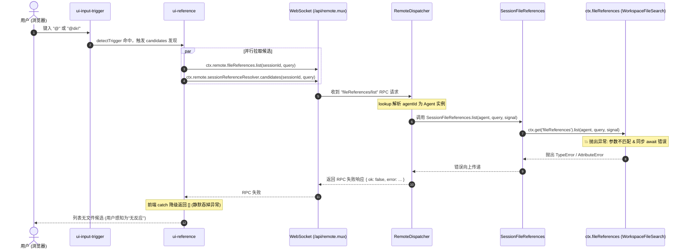

# Web 输入框 @ 引用文件未索引原因分析与未迁移包全景审查报告

> 2026-10-15 补记：以下是切换前的静态评估，包数量和完成状态以 [行动评估中的校正](2026-10-14-rc1-baseline-and-capability-action-plan.md) 为准。文件引用现已完成提供端、Remote、多工作区及原样浏览器 fresh/cold 验证；当前274-manifest 能力矩阵仍逐项区分实现、激活与证据。详见 [实施与完整签收](2026-10-15-rc1-baseline-migration-progress.md)。

**日期**：2026-10-14  
**审查方式**：静态代码与架构契约审查（Static Code & Contract Inspection）  
**当前基线**：`dsh-v0.1.2-alpha.1`（Commit: `cd5ef8148158c3a752a658978873241fdf8e2bbc`）  
**当前产品发布状态**：`v0.1.1` 单次完整 CI 门禁通过（Portable 发布候选）  

---

## 1. 背景与审查目标

在 Windows 7 环境下运行 DeepSeek Harness Web GUI（`dsh --profile web` / `dsh-web.bat`）时，用户在底部对话框中输入 `@` 字符，发现系统**不会自动列出并索引当前文件夹中的文件候选**。

为定位该行为的根本原因并排查当前代码库中还存在哪些尚未完成迁移的包，本次审查通过纯静态分析（Static Inspection，不触发动态测试及门禁）：
1. 深入追踪 `@` 符号从前端触发、WebSocket RPC 通信到后端索引执行的全链路调用；
2. 对照官方原版（TypeScript 实现）的 Cordis 插件与 Typert Remote 架构设计；
3. 全面盘点上游 254 个包在当前 Win7 Python 移植版中的对齐状态与剩余未迁移清单。

---

## 2. Web 端 `@` 文件引用未索引的原因深度审查

### 2.1 链路时序与调用流程

Web 界面中的 `@` 自动补全链路跨越了浏览器前端、WebSocket 多路复用 RPC、以及后端 Cordis 服务层：



### 2.2 根本原因定位

#### 原因 1：接口签名与参数类型严重断裂（Signature & Type Mismatch）
- **RPC 控制器层**：在 [`dsh/api/session_catalogs.py`](file:///d:/Project/deepseek-harness-win7/dsh/api/session_catalogs.py#L8-L16) 中，`SessionFileReferences` 定义如下：
  ```python
  class SessionFileReferences(TypertRemoteService):
      inject = ['fileReferences', 'typert']

      @Remote
      async def list(self, agent, query, signal):
          return await self.ctx.get('fileReferences').list(agent, query, signal)
  ```
  `RemoteDispatcher` 根据方法签名，将客户端传来的 `agentId` 解析为 `agent: Agent` 实例，传递给 `list(agent, query, signal)`。共 3 个参数（含 `self` 4 个）。
- **底层服务提供层**：在 [`dsh/context/file_reference_local/__init__.py`](file:///d:/Project/deepseek-harness-win7/dsh/context/file_reference_local/__init__.py#L43-L48) 中，插件直接将 `WorkspaceFileSearch` 实例作为 `fileReferences` 服务注册到了 `ctx`：
  ```python
  self.searcher = WorkspaceFileSearch(cwd, ...)
  ctx.set_service("fileReferences", self.searcher)
  ```
- **参数致命冲突**：查看 [`dsh/context/file_reference_local/search.py`](file:///d:/Project/deepseek-harness-win7/dsh/context/file_reference_local/search.py#L90)：
  ```python
  class WorkspaceFileSearch:
      def list(self, raw_query: str = "", signal: Any = None) -> List[Dict[str, str]]:
  ```
  1. **参数数量冲突**：`WorkspaceFileSearch.list` 仅接收 `self, raw_query, signal` 3 个参数。当调用 `fileReferences.list(agent, query, signal)` 时，总共传了 4 个位置参数，直接触发：
     `TypeError: list() takes from 1 to 3 positional arguments but 4 were given`；
  2. **参数类型冲突**：即使参数个数勉强匹配，第一个参数传入的是 `Agent` 对象，而内部代码执行了 `query = raw_query.replace("\\", "/")`，`Agent` 没有任何 `replace` 字符串方法，直接触发：
     `AttributeError: 'Agent' object has no attribute 'replace'`。

#### 原因 2：同步返回值与 `await` 语法冲突（Sync/Async Mismatch）
`WorkspaceFileSearch.list` 是一个普通的同步函数，返回原生 `List[Dict[str, str]]`。
然而在 `session_catalogs.py` 中写了：
```python
return await self.ctx.get('fileReferences').list(agent, query, signal)
```
在 Python 中对非 awaitable 的 `list` 执行 `await`，会抛出致命错误：
`TypeError: object list can't be used in 'await' expression`。

#### 原因 3：前端对 Remote 错误默认静默降级（Silent Failure）
在前端源码 [`packages/client/ui-reference/src/client/index.ts`](file:///d:/Project/deepseek-harness-win7/packages/client/ui-reference/src/client/index.ts#L51-L54) 中：
```typescript
const fileLookup = ctx.remote.fileReferences.list(session.sessionId, query, signal).then(
  result => result.ok ? result.value : [],
  () => [],
)
```
官方契约设计要求“候选发现失败有意保持静默”（见 [ui-reference/README.zh.md](file:///d:/Project/deepseek-harness-win7/packages/client/ui-reference/README.zh.md#L90)）。当后端抛出上述异常并返回 `ok: false` 时，前端捕获后静默返回空数组 `[]`，没有任何控制台报错或弹窗，在界面上表现为完全不展示文件列表。

#### 原因 4：多会话工作区隔离机制缺失
在 Web 多会话模式下，每个 Session 可以绑定不同的工程目录（`agent.session.header.cwd`）。
官方实现中由 `LocalFileReferenceService` 为每个 `Agent` 动态实例化与缓存对应的 `WorkspaceFileSearch`；而当前 Python 版在插件加载时直接用主进程的 `os.getcwd()` 生成了唯一的单例，无法适配多工作区场景。

#### 原因 5：官方迁移进度处于未开始（`unstarted`）
查看 `migration/status.md`：
- `@deepseek-ai/dsh-file-reference`：`unstarted`
- `@deepseek-ai/dsh-file-reference-local`：`unstarted`
当前仓库中的 `dsh/context/file_reference_local` 仅是一份临时的粗糙草稿，甚至混入了在 `agent/pre-step` 阶段直接读取文件全文并内联到 Prompt 中的非官方逻辑。

---

## 3. 官方原版（Upstream TypeScript）的设计规格

官方 DeepSeek Harness 的 `@` 自动补全严格遵循 **Cordis 插件化**与 **Token 成本最小化** 原则：

### 3.1 前端交互与建议层 (`ui-input-trigger` + `ui-reference`)
1. **触发识别**：在 `ui-input-trigger` 中，通过纯函数正则 `(?:^|\s)(@([^\s]*))$` 检测行首或空格后的 `@`，同时支持带引号的 `@"path with spaces`。
2. **并行发现**：前端输入 `@` 时，并发调用两路 Remote：
   - 文件引用：`ctx.remote.fileReferences.list(sessionId, query, signal)`
   - 会话引用：`ctx.remote.sessionReferenceResolver.candidates(sessionId, query, signal)`
3. **渲染规则**：
   - 文件分组排在会话分组之前；
   - 文件夹项带有尾随斜杠 `/`，支持通过 `Tab` 或行尾 Chevron 进行**目录层级下钻（Drill-down）**；
   - 面包屑机制记录下钻路径，点击上一级面包屑可随时返回上层。

### 3.2 核心理念：选中 `@` 绝不内联文件内容
原版设计与当前 Python 草稿中的“内联全文”完全相反：
- **严格禁止内联文件正文**：选择文件候选项后，**仅在输入框光标处插入规范的纯文本 Mention**（如 `@src/index.ts` 或 `@"dir name/file.py"`）。
- **提示词协同**：宿主仅向模型系统提示词安装一条静态指引（`FILE_REFERENCE_PROMPT`）：
  > *"Tokens prefixed with @ are workspace paths the user explicitly referenced, relative to the workspace root. A trailing slash marks a directory: list it when its contents matter. Anything else is a file: use the read tool when its contents are needed, and do not claim to have inspected it before reading."*
- **设计收益**：把“是否需要读取文件、何时读取、读取多少”的决定权交给模型（通过调用 `read` 工具）。避免用户一旦引用大文件就造成 Token 和 KV Cache 的巨大浪费。

### 3.3 后端分层架构
- **RPC 适配器**：[`packages/api/session-controller/src/file-references.ts`](file:///d:/Project/deepseek-harness-win7/packages/api/session-controller/src/file-references.ts) 继承 `TypertRemoteService`，声明 `@Remote list(agent: Agent, query: string, signal: AbortSignal)`。
- **抽象服务契约**：[`packages/context/file-reference/src/index.ts`](file:///d:/Project/deepseek-harness-win7/packages/context/file-reference/src/index.ts) 定义 `FileReferenceService` 抽象类。
- **本地文件发现服务**：[`packages/context/file-reference-local/src/index.ts`](file:///d:/Project/deepseek-harness-win7/packages/context/file-reference-local/src/index.ts) 继承该服务，持有一个 `Map<Agent, WorkspaceFileSearch>`，在收到 `tools/result` 事件时触发缓存失效并后台重建。
- **有界模糊索引器**：[`WorkspaceFileSearch`](file:///d:/Project/deepseek-harness-win7/packages/context/file-reference-local/src/search.ts) 实现了带大小限制（50,000 条条目上限、20 条结果截断）、目录过滤（排除 `.git`、`node_modules` 等）的高性能异步搜索。

---

## 4. 未迁移包（Unmigrated Packages）全景审查

在官方 `reference/` 目录中，共有 **254 个包清单**。
经由 `dsh/boot/plugin_registry.py`、`dsh/client/surfaces.py` 以及 Python 运行时的全量静态比对：
- **已迁移并挂载**：**163 个核心包**（覆盖了 Standard、Creative、Minimal、Headless 及 Web 全线运行时）；
- **未挂载/差异包**：共 **91 个包**。

分类审查如下：

### 4.1 核心未迁移能力（高相关性）
| 包名 | 官方位置 | 类别 | 功能说明与现状 |
|---|---|---|---|
| `@deepseek-ai/dsh-file-reference` | `context/file-reference` | runtime | `@file` 引用的抽象服务契约与 Mention 语法解析器 |
| `@deepseek-ai/dsh-file-reference-local` | `context/file-reference-local` | runtime | 本地工作区文件模糊索引与搜索服务（当前为不兼容草稿） |
| `@deepseek-ai/dsh-lsp` | `lsp/lsp` | runtime | 语言服务器协议（LSP）抽象与连接生命周期 |
| `@deepseek-ai/dsh-lsp-stdio` | `lsp/lsp-stdio` | runtime | 基于 STDIO 的本地 LSP 服务器通信通道 |
| `@deepseek-ai/dsh-tool-lsp` | `lsp/tool-lsp` | runtime | 提供给模型的 LSP 代码符号检索与定义跳转工具 |

### 4.2 外部云服务与第三方集成（依赖外部环境）
| 包名 | 官方位置 | 类别 | 说明 |
|---|---|---|---|
| `@deepseek-ai/dsh-web-search-exa` | `web/web-search-exa` | runtime | Exa 语义化 Web 搜索提供方（当前仅实现了 DeepSeek Search） |
| `@deepseek-ai/dsh-web-search-perplexity` | `web/web-search-perplexity` | runtime | Perplexity Web 搜索提供方 |
| `@deepseek-ai/dsh-webhook` | `webhook/webhook` | runtime | Webhook 服务端核心 |
| `@deepseek-ai/dsh-webhook-github` | `webhook/webhook-github` | runtime | GitHub Webhook 事件解析与 Agent 唤醒 |
| `@deepseek-ai/dsh-e2b` | `e2b/e2b` | runtime | E2B 云端沙盒环境管理器（Win7 聚焦本地执行，无云沙盒） |
| `@deepseek-ai/dsh-fs-e2b` | `e2b/fs-e2b` | runtime | E2B 远程容器文件系统适配器 |
| `@deepseek-ai/dsh-subprocess-e2b` | `e2b/subprocess-e2b` | runtime | E2B 远程容器子进程适配器 |

### 4.3 外部 CLI 生态与第三方子代理
| 包名 | 官方位置 | 类别 | 说明 |
|---|---|---|---|
| `@deepseek-ai/dsh-subagent-claude-code` | `subagent/subagent-claude-code` | runtime | 桥接运行 Anthropic Claude Code 命令行 Agent |
| `@deepseek-ai/dsh-subagent-codex` | `subagent/subagent-codex` | runtime | 桥接运行 OpenAI Codex 命令行 Agent |
| `@deepseek-ai/dsh-subagent-dsh-sdk` | `subagent/subagent-dsh-sdk` | runtime | 跨进程 SDK 子代理适配器 |
| `@deepseek-ai/dsh-hook-protocol` | `hooks/hook-protocol` | runtime | 外部 Agent Hook 协议 |
| `@deepseek-ai/dsh-hooks-claude-code` | `hooks/hooks-claude-code` | runtime | Claude Code 专用 Hook 监听器 |
| `@deepseek-ai/dsh-hooks-codex` | `hooks/hooks-codex` | runtime | Codex 专用 Hook 监听器 |

### 4.4 POSIX 专属包（因 Win7 平台而明确不迁移/已有替代）
| 包名 | 官方位置 | 平台说明与 Win7 替代方案 |
|---|---|---|
| `@deepseek-ai/dsh-bash-local` | `shell/bash-local` | Linux/macOS Bash 本地执行器；Win7 下由 `dsh-pwsh-local` 替代 |
| `@deepseek-ai/dsh-bash-sandbox` | `shell/bash-sandbox` | Linux Bash 沙盒；Win7 下由 `dsh-pwsh-sandbox` 替代 |
| `@deepseek-ai/dsh-tool-bash` | `shell/tool-bash` | 模型 Bash 工具；Win7 下由 `dsh-tool-pwsh` 替代 |
| `@deepseek-ai/dsh-tool-bash-persistent` | `shell/tool-bash-persistent` | 持久 Bash 会话；Win7 下由 `dsh-tool-pwsh-persistent` 替代 |
| `@deepseek-ai/dsh-terminal-bash` | `terminal/terminal-bash` | 伪终端 Bash 适配；Win7 下由 PowerShell 虚拟终端替代 |
| `@deepseek-ai/dsh-tmux-context` | `context/tmux-context` | 依赖 Linux tmux；Win7 不支持 |

### 4.5 实验性功能分支（Experimental Features）
| 包名 | 官方位置 | 说明 |
|---|---|---|
| `@deepseek-ai/dsh-experimental-agent-team` | `experimental/agent-team` | 多智能体协作团队套件核心 |
| `@deepseek-ai/dsh-experimental-agent-team-profile` | `experimental/agent-team-profile` | Agent Teams 宿主 Profile 层 |
| `@deepseek-ai/dsh-experimental-agent-team-web-profile`| `experimental/agent-team-web-profile` | Agent Teams Web 界面配置 |
| `@deepseek-ai/dsh-experimental-tool-agent-team` | `experimental/tool-agent-team` | 团队协作模型工具 |
| `@deepseek-ai/dsh-experimental-client-ui-agent-team` | `experimental/client-ui-agent-team` | 前端团队协作看板与成员面板 |
| `@deepseek-ai/dsh-experimental-inspector` | `experimental/inspector` | 运行时交互与调用审查器 |
| `@deepseek-ai/dsh-experimental-webworker-runtime` | `experimental/webworker-runtime` | 浏览器内 WebWorker 本地计算运行时 |
| `@deepseek-ai/dsh-experimental-webworker-packer` | `experimental/webworker-packer` | WebWorker 打包工具 |

### 4.6 架构内聚包与底层微包（在 Python 侧直接实现，未单独发包）
在官方 TS 单体仓库中，大量纯接口或简单工具被拆分为了独立的 npm 模块。而在 Python 侧，这些功能已直接内聚在相应的领域模块中：
- **抽象服务契约**：`dsh-fs`、`dsh-jobs`、`dsh-sandbox`、`dsh-subprocess`、`dsh-session-persistence`、`dsh-compaction`、`dsh-session-telemetry`；
- **公共工具微包**：`dsh-atomic-write`、`dsh-brand`、`dsh-home-paths`、`dsh-launch-environment`、`dsh-timeout`、`dsh-util-crypto`、`dsh-util-workspace-path`（已内聚在 `dsh.cordis` 与 `dsh.core`）；
- **前端编译子包**：`dsh-client-store`、`dsh-client-ui-primitives`、`dsh-client-ui-slots`、`dsh-client-web`（已统一由 Vite 编译打包在 `apps/web/dist` 中，无需 Python 宿主单独挂载）；
- **开发与测试工具**：`dsh-typert-generator`（TypeScript RPC 代码生成器）、`dsh-llm-mock-server`、`dsh-agent-loop-testkit` 等。

---

## 5. 结论与后续演进建议

1. **`@file` 文件索引修复优先级最高（P0）**：
   - 现存的 `dsh/context/file_reference_local` 代码与上层 `SessionFileReferences` RPC 控制器存在参数与异步类型断裂。
   - 修复路径非常明确：按原版标准引入 `LocalFileReferenceService`，使其接受 `(agent, query, signal)`；内部按 `agent.session.header.cwd` 路由到对应的 `WorkspaceFileSearch`；将 `list` 声明为兼容的异步方法，且移除在 `agent/pre-step` 中强行内联文件全文的非官方行为。
2. **对于其他未迁移包（P1 ~ P3）**：
   - **LSP 支持（P1）**：若需提供高级代码补全与跨文件跳转能力，可规划移植 `dsh-lsp` 与 `dsh-tool-lsp`。
   - **第三方搜索与 Webhook（P2）**：按业务需求作为可选插件引入，目前官方 DeepSeek 搜索已能覆盖主流诉求。
   - **POSIX 与 E2B 云沙盒（不迁移）**：明确属于平台互斥项，继续保持 Win7 本地化与 PowerShell 执行体系。
