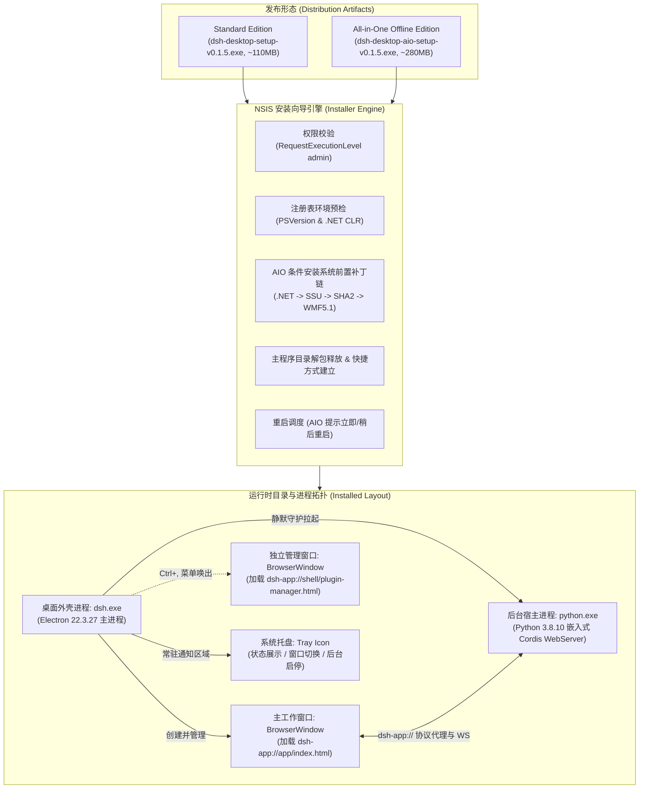
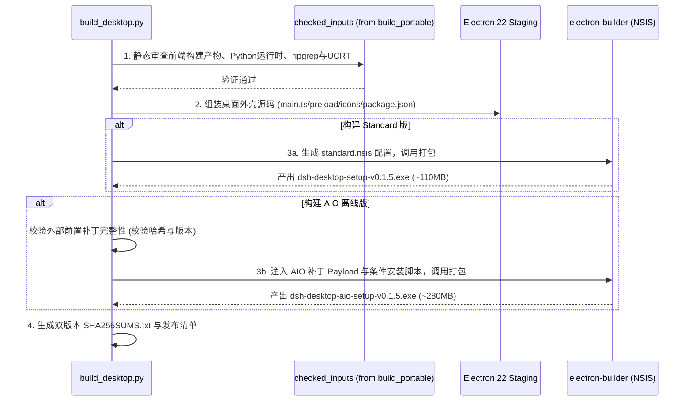

# DeepSeek Harness Win7 - 基线跃迁 dsh-v0.1.5-rc.3 与桌面端双版本安装包（Standard / AIO）落地方案评估报告

> 2026-10-18 最终实测补充：本文为初始方案，“100%同构/无任何现代API摩擦”不是验收结论。Electron22的AccentColor已用独立兼容样式处理；22/44同机120视图、60对控件检查通过，原生插件表单最大差2 CSS px。新候选`6cbcbf1c`完成双架构分发、六组实际管理员旅程、真实provider和本地私有CA签名更新；Win7真机和实际内网服务器部署按用户决定延期。见[最终完成记录](2026-10-18-desktop-completion-validation.md)。

**日期**：2026-10-16  
**作者**：Antigravity Agent  
**性质**：架构设计与工程落地方案评估（静态审查，未修改业务代码，未执行自动化测试）  
**目标原版基线**：`dsh-v0.1.5-rc.3`（Commit: `a4c74a91e06b00fe0b0937bde982170c526cc842`）  
**目标操作系统**：Windows 7 SP1 (x64 / x86) 及更高版本（兼容 Windows 10/11）  
**目标 Python 运行时**：Python 3.8.10 (32-bit / 64-bit) 零依赖便携环境  

---

## 1. 背景与产品目标界定

本项目（`deepseek-harness-win7`）的核心目标是维护一个轻量、高扩展性、**严格原生兼容 Windows 7 SP1 与 Python 3.8.10** 的官方 DeepSeek Harness Cordis 架构实现。在刚完成的 `dsh-v0.1.2-rc.1` 阶段中，系统已建立稳定的 Web 运行时、完整的 Python 服务体系与 Chromium 108 自动化验证闭环。

针对下一步产品演进，团队确立了两项并行的核心目标：
1. **基线升级**：将对齐的原版官方基线推进至稳定收官版 **`dsh-v0.1.5-rc.3`**，吸收 Mermaid/Graphviz/SVG 流程图渲染、Dockkit 多面板、侧边栏文件树预览及 DeepSeek V4 模型目录等高价值功能。
2. **Desktop 安装包分发**：不再局限于 `.bat` 脚本启动的便携目录，而是引入标准化的 Windows 安装包（Setup.exe），提供 1:1 还原原版桌面软件的窗体、菜单与系统集成体验。
3. **双版本分发策略**：
   - **标准轻量版（Standard Edition）**：面向常规环境，体积轻巧（~110MB），秒级安装。不生成冗余快捷方式；若预检发现缺失现代环境组件，安装完成页直接弹出图文指引，并在分发时同级配套提供独立的【Win7离线环境升级包.zip】。
   - **全量一体化离线版（All-in-One Offline Edition）**：面向纯净无网的 Windows 7 SP1 隔离内网机，集成系统前置支持包（含 SSU 服务堆栈、SHA-2 证书支持、PowerShell 5.1 / WMF 5.1 与 .NET Framework 4.5.2+ 运行库），实现一键式开箱即用。

> [!IMPORTANT]
> **资源引用合规原则**：系统前置离线补丁集合属于外部独立提供的环境支持载体，**不作为 Git 仓库的受控源码管理，构建脚本中通过外部参数目录传入，代码和文档中不硬编码任何本地私有文件绝对路径**。

---

## 2. 核心架构设计：基于 Electron 22 的 1:1 桌面宿主

### 2.1 为什么选定 Electron 22.3.27？
审查上游原版 `apps/desktop` 源码可知，官方引入的 Desktop 是基于 **Electron 44.0.0** + `electron-builder` 构建的。然而，Electron 官方自 23 版本起彻底移除了对 Windows 7/8/8.1 的支持。

因此，唯一能够兼顾 **“1:1 还原桌面端体验”** 与 **“Windows 7 SP1 原生兼容”** 的技术路径是：
- 锁定 **`Electron 22.3.27`**（Electron 22 的最终收官维护版，也是官方支持 Windows 7 的最后一个版本）。
- 其内置内核为 **Chromium 108.0.5359.215 + Node.js 16.17.1**。
- 这与本项目当前既有的 **Chromium 108 自动化验证基线与 CSS/JS 垫片体系（`compat.js`）完全重合**，从渲染机制上保证了 100% 同构，无任何现代 API 摩擦。

### 2.2 整体架构拓扑图



---

## 3. 双版本（Standard vs AIO）安装包方案深度设计

### 3.1 共同底座：系统环境检测矩阵（Pre-flight Detection Engine）

两版安装程序均内置统一的环境检测逻辑，通过静默查询 Windows 注册表进行状态识别：

| 检查项 | 目标注册表路径与键值 | 合格标准（Pass） | 缺失表现（Defect） |
|---|---|---|---|
| **PowerShell 版本** | `HKLM\SOFTWARE\Microsoft\PowerShell\3\PowerShellEngine` -> `PowerShellVersion` | `>= 5.1.0` | 原生 Win7 默认只有 `2.0` |
| **.NET Framework 运行时** | `HKLM\SOFTWARE\Microsoft\NET Framework Setup\NDP\v4\Full` -> `Release` | `>= 379893` (.NET 4.5.2)<br>建议 `>= 461808` (.NET 4.7.2) | 键值不存在或 Release < 379893 |
| **SHA-2 代码签名支持** | `HKLM\SOFTWARE\Microsoft\Windows\CurrentVersion\Component Based Servicing\Packages` 下查询 `KB4474419` | 补丁已安装（State=112） | 缺少现代 SHA-2 代码签名算法支持 |
| **服务堆栈更新 (SSU)** | 同上，查询 `KB4490628` | 补丁已安装（State=112） | 更新服务引擎无法处理现代补丁 |

---

### 3.2 版本一：标准轻量版（Standard Edition）落地细节

* **定位**：常规桌面用户首选，体积轻便、极速安装、失败隔离。
* **分发体积**：约 **110MB ~ 120MB**。
* **分发配套设计**：在发布渠道中，除提供主安装包外，同级配套提供一个独立打包的【Win7离线环境升级包.zip】（供需要升级原生老旧 Win7 系统的用户选用）。
* **安装包构成**：
  1. Electron 22 预编译壳资源（`dsh.exe`、核心动态链接库、ICU 数据）。
  2. 嵌入式 Python 3.8.10 运行库（`lib/`、UCRT 运行时、`rg.exe`）。
  3. `apps/web/dist` 原版静态资源与 `compat.js` 垫片。
* **安装向导与指引交互设计（无无关快捷方式）**：
  - **整洁性原则**：绝不在桌面或开始菜单中添加与主程序无关的快捷方式，保持用户操作系统纯净整洁。
  - **安装过程**：秒级释放，用户无需等待漫长的系统补丁安装。
  - **完成页检测与引导弹窗**：
    - 若预检判定 PowerShell `>= 5.1` 与 `.NET 4.5.2+`：显示绿色对勾“系统环境已就绪”，直接提供“立即运行 DeepSeek Harness”选项。
    - 若预检判定当前系统处于原生老旧的 PowerShell 2.0 环境：
      - 安装向导完成页主动弹出一个醒目的图文指引对话框/完成页说明：
        > “【系统环境提示】检测到当前为基础 Windows 7 环境（PowerShell 2.0）。DeepSeek Harness 已成功安装并可正常运行基础交互；若需解锁复杂的终端与自动化特性，请使用分发时同级配套提供的【Win7离线环境升级包.zip】进行一键升级。点击[查看升级指南]可直接浏览详细图文操作步骤。”
* **应用内初次启动提示**：
  - 客户端首次启动进入主界面时，若底层依然为 PowerShell 2.0，仅在前端顶部展示一个轻量的可关闭提示条，不打扰日常使用，向有高级终端需求的用户提供图文指引入口。

---

### 3.3 版本二：全量离线一体化版（All-in-One Offline Edition）落地细节

* **定位**：纯净、完全断网的 Windows 7 SP1 隔离内网机，要求“一个安装包搞定全部依赖”。
* **分发体积**：约 **260MB ~ 290MB**。
* **前置补丁 Payload 组织（外部传入）**：
  打包时由构建脚本将外部准备好的前置安装包作为资源挂载入 NSIS Payload：
  - `.NET Framework 4.7.2` 离线完整安装包（~80MB）
  - `KB4490628`（SSU 服务堆栈补丁，x64/x86）
  - `KB4474419`（SHA-2 代码签名补丁，x64/x86）
  - `KB3191566`（WMF 5.1 / PowerShell 5.1 核心补丁，x64/x86）
* **NSIS 自定义页面与执行时序**：
  1. **提权要求**：安装包声明 `RequestExecutionLevel admin`，启动时请求管理员权限。
  2. **组件定制选择页（Component Selection Page）**：
     - `[√] DeepSeek Harness 桌面应用核心`（必选，锁定勾选）
     - `[?] Windows 7 系统增强组件 (PowerShell 5.1 & .NET 4.7.2)`：
       - **自动判断**：若预检发现系统已满足 PS 5.1，则该项自动取消勾选、置灰，并标注“（当前系统已具备，无需安装）”；
       - 若系统缺失，则默认打勾，标注“（内网纯净 Win7 必需，安装后需重启）”。
  3. **防死锁与容错安装链**：
     针对 Windows 7 独有的 Update 服务可能挂起的问题，安装链加入保护机制：
     ```nsis
     ; 步骤 0: 确保 Windows Update 服务处于可用状态
     ExecWait 'net.exe start wuauserv'
     
     ; 步骤 1: 静默安装 .NET 4.7.2 运行库（带 10 分钟看门狗超时）
     DetailPrint "正在安装 .NET Framework 运行库..."
     ExecWait '"$PLUGINSDIR\prereq\NDP472-KB4054530-x86-x64-AllOS-ENU.exe" /q /norestart' $0
     
     ; 步骤 2: 安装 SSU 服务堆栈更新 (KB4490628)
     DetailPrint "正在更新 Windows 7 服务堆栈 (KB4490628)..."
     ExecWait 'wusa.exe "$PLUGINSDIR\prereq\windows6.1-kb4490628-x64.msu" /quiet /norestart' $0
     
     ; 步骤 3: 安装 SHA-2 签名支持 (KB4474419)
     DetailPrint "正在安装 SHA-2 签名支持 (KB4474419)..."
     ExecWait 'wusa.exe "$PLUGINSDIR\prereq\windows6.1-kb4474419-v3-x64.msu" /quiet /norestart' $0
     
     ; 步骤 4: 安装 WMF 5.1 / PowerShell 5.1 核心包 (KB3191566)
     DetailPrint "正在安装 PowerShell 5.1 核心更新 (约需 2-5 分钟)..."
     ExecWait 'wusa.exe "$PLUGINSDIR\prereq\Win7AndW2K8R2-KB3191566-x64.msu" /quiet /norestart' $0
     ```
  4. **安装完成与重启交互**：
     - 若实际执行了系统补丁升级，NSIS 激活系统重启指令：
       - 单选框 1：`立即重新启动计算机 (推荐)`（默认选中）
       - 单选框 2：`稍后手动重新启动`
     - 确保用户明确知晓：PowerShell 5.1 需要在重启后才能正式被系统内核加载。

---

## 4. 构建与工程发布脚本设计（`scripts/build_desktop.py`）

为了实现标准化的持续集成与构建，在 `scripts/` 下新增桌面打包专用入口 `scripts/build_desktop.py`。该脚本复用现有的便携包验证模块，但引入双版本的组装逻辑。

### 4.1 CLI 参数设计
```powershell
python scripts/build_desktop.py --edition [standard|aio|both] [--external-prereq-dir <PATH>] [--output-dir <PATH>]
```
- `--edition`：指定构建版本（`standard` 构建标准版，`aio` 构建全量一体化离线版，`both` 同时构建两者）。
- `--external-prereq-dir`：指定系统前置补丁所在的外部离线目录路径（仅在构建 `aio` 时必需；不设置时若选择 `aio` 会阻断退出并给出明确提示）。
- `--output-dir`：输出安装包目录（默认输出至 `dist/`）。

### 4.2 构建流水线四阶段



---

## 5. 实施路线图与阶段性里程碑

实施工作划分为四个清晰解耦的阶段，确保每个阶段有明确的退出标准：

| 阶段 | 核心任务 | 交付物与验证标准 |
|---|---|---|
| **Phase 1: 基线跃迁** | 切换至 `dsh-v0.1.5-rc.3`<br>更新 `migration/baseline.json` 与前端产物 | 1. `apps/web/dist` 同步 Mermaid、Dockkit 与新版样式<br>2. 现有 Chromium 108 浏览器渲染与会话恢复测试通过 |
| **Phase 2: 桌面外壳工程化** | 适配 `apps/desktop` 至 Electron 22<br>实现 Python 宿主静默守护与协议代理 | 1. 完成 `dsh.exe` 启动并成功通信本地 Python 进程<br>2. 快捷键呼出独立 Plugin Manager 窗口与单实例互斥生效 |
| **Phase 3: NSIS 脚本与双版封装** | 编写 NSIS 注册表预检逻辑<br>实现 Standard 诊断与 AIO 条件安装脚本 | 1. 验证在已有 PS 5.1 环境下 AIO 补丁能智能跳过<br>2. 验证在原生 Win7 下 AIO 能按序静默安装并提示重启 |
| **Phase 4: 统一资格与发布** | 编写 `scripts/build_desktop.py`<br>执行统一资格门禁与打包验证 | 1. 产出双版本安装包并核对 SHA256<br>2. 在全新解压与安装环境下验证无外网正常启动与运行 |

---

## 6. 总结

采用 **“以 Electron 22 为外壳实现 1:1 桌面级体验，并以 Standard / All-in-One 双版本满足不同场景”** 的技术方案，既彻底解决了 Windows 7 SP1 的现代 OS API 缺失问题，又实现了桌面客户端软件在纯净内网离线机上的极简交付。

本方案在保持主仓库纯洁性（不将笨重系统补丁代码库化）的同时，兼顾了软件体积、安装鲁棒性与用户体验的平衡，具备高度的可实施性。
