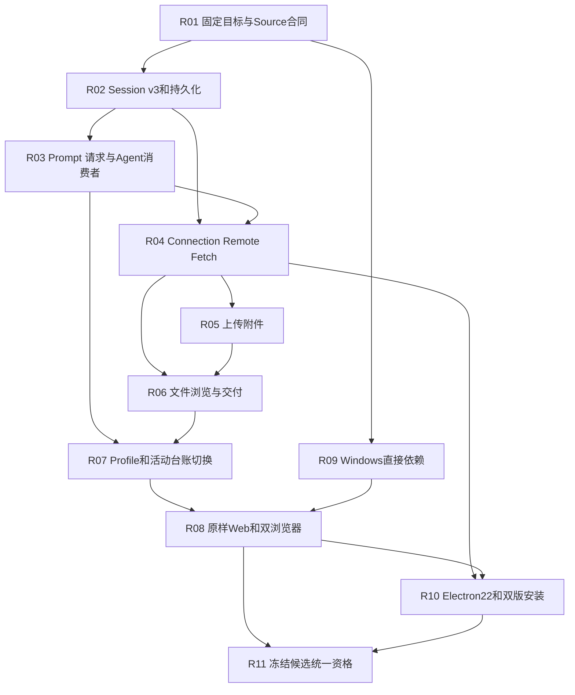

# dsh-v0.1.5-rc.3 基线推进：非 Desktop 部分的实施路径评估

日期：2026-10-16。性质：固定 Git tree 差分、源码合同审查与实施方案；本轮未迁移业务代码或切换活动 pin。

## 1. 结论与边界

可以将下一轮对齐目标定为 **`dsh-v0.1.5-rc.3` / `a4c74a91e06b00fe0b0937bde982170c526cc842`**，但应按跨模块迁移批次推进。主要工作是 **Session v3 与已发布格式迁移、系统提示词/请求历史语义、文件服务与原样 Web 消费者的共同闭包**，不是只替换前端资源和模型目录。整体复杂度高，优先安排持久化与请求语义；完成这些提供端后再进行正式前端导入。

Desktop 遵循指定的 [Desktop / Standard / AIO 调研](2026-10-16-dsh-v0.1.5-rc3-desktop-distribution-evaluation.md)：Electron 22.3.27、Python 3.8.10 宿主、Standard/AIO 双分发、外置补丁输入及独立安装验收。本报告补充它与共享 Host 的接口和门禁依赖，不重新选择桌面技术路线。该报告中的体积、启动速度、“100% 同构”等是待测预期，不能作为已取得的兼容证据。

当前正式活动目标仍是 `dsh-v0.1.2-rc.1` / `a66e4702047846cdaa10c66c9d3df3951f5ea70d`。已合格代码为 `d5f74c2d`，本次评估工作树起点为 `f4f9d2ab`。`accepted_upstream` 仍为 null；rc.1 的完整回执只覆盖它绑定的有限合同、输入与实际 ZIP。

建议先推进 R01–R04 的合同与候选准备，再推进 R05–R09 的关联实现；R10 的桌面壳可在共享 Connection/Host 边界明确后开始，完整应用验收等待共享链路稳定。LSP、云搜索、E2B、外部 CLI 等保持按实际 profile 可达性决定的独立范围。

## 2. 本次观察及对早期判断的校正

固定目标已同时核对本地 tag 与 [上游 Release 页面](https://github.com/deepseek-ai/deepseek-harness/releases/tag/dsh-v0.1.5-rc.3)。代码判断以该 SHA 的最终 tree 为准，不以曾合入的功能提交或较新 master 为准。

| 项目 | 本次实际观察 | 对实施的影响 |
|---|---|---|
| 差分起点 | 已活动的 rc.1，非 alpha.1 | 避免把已完成的 lineage、文件引用和轮次摘要作为全新工作重复实施。 |
| 提交与路径 | 1,493 个可达差分提交；完整重命名检测下 6,531 条变更，204,906 行增、54,793 行删 | 数量包含文档、Agent Notes、测试和快照，不可直接换算实现工时。 |
| 变更状态 | M=3,134、A=1,793、R=1,135、D=469 | 路径重排和职责迁移必须同时检查两端。 |
| 全部 manifest | 274 → 297，路径新增27、删除4，无同路径包名变化 | 不是“50个包保持一致”，也不等于新增23项运行能力。 |
| 目标角色分类 | runtime=217、frontend=56、platform=8、tooling=9、fixture=7 | 沿用现有分类器，分类只辅助分派；例如 benchmark 仍需人工归类。 |
| Session writer | 本产品 `SESSION_FORMAT_VERSION=0`，目标为3 | 先迁移日志、restorer、projection/查询及依赖消费者。 |
| Mermaid / Graphviz 围栏预览 | `58956c1a8a` 撤回该功能；目标 client tree 的 `mermaid` / `graphviz` 搜索无命中 | 不将它列为 rc.3 原版功能或本批默认交付；若需要，应另立扩展需求。SVG/HTML 的文件预览与代码围栏渲染分别核对。 |
| 默认模型 | 目标新增 `deepseek-flash`，显示名 DeepSeek-V41-Flash，同时保留 V4 系列 | 当前 Python 已有 V4 目录，差距不只是“新增 V4”；还涉及 `systemPromptUpdate`、实际默认路由及设置修复。 |
| minimal | 目标 preset 和 sdk-minimal 删除编辑器，只保留持久 shell | 与本项目 AGENTS.md 的“两工具”要求冲突，见第7节的显式差异处理。 |
| 文件交付 | 目标 `present` 最终语义为路径声明、打开当前源文件；README明确不复制正文 | 不按中途“immutable delivery/download”提交描述实现已撤换的合同。上传附件的不可变字节与交付文件的当前路径是两套语义。 |

正式只读 `upstream_delta.py` 已成功运行，但默认 Git 重命名上限跳过穷尽检测，得到6,774条路径状态；它依据旧 pin 的 owner/dependency 图，新增目录可能归到根包。为方案核算另执行 `-c diff.renameLimit=10000`，无警告，得到上述6,531条。两份观察都保留，不把默认观察中的258个受影响旧 owner 或“0 transitive”当成目标依赖闭包。

完整目标 manifest、原始字节 SHA、声明依赖、当前 Loader 字符串映射和建议审查行动写入 [候选 assessment.json](../../migration/candidates/rc3/assessment.json)。297行均为 `not-evaluated-for-rc3`；注册映射存在不证明行为，空映射也不能直接判作功能缺失。profile 实际可达性和条件激活仍需 R01 实测。

## 3. 必须先闭合的基础合同

### 3.1 Session v0 → v3：最高风险与关键路径

目标增加 `session-format`、`session-format-catalog` 与相邻 v0→v1、v1→v2、v2→v3 三条迁移边。依据目标 `session-persistence-jsonl/README.md` 与三条迁移包，实施必须包含：

- **版本化物理布局和不可变历史代际**：每个 Session 自有目录，选择最高 canonical generation；只读 open 在内存中转换，不发布新代际；写 open 才在同目录暂存、验证、重新检查源 revision 后无覆盖发布。旧日志字节保持，失败不静默退回低版本。
- **相邻转换而非数字替换**：v0→v1 保持经验证布局；v1→v2 将 Assistant 顶层流片段收入 message，未认领 attempt 形成 log-only 记录，事件数量及引用会改变；v2→v3 插入 system/message 并再次重映射。禁止只把 header.version 改成3。
- **继承边界和引用**：v3 从最后一个带 `inherited: true` 的 `session/end-seed` 得出 cut；同时处理 `sourceEventSeqs`、surface replacement、compaction范围、标题引用。delivery、session-reference 的捕获代际/坐标和任意业务数字不递归改写。
- **v3 envelope**：`surfaceOp` replacement 使用 `startSeq/endSeq`；四类 surface 事件、Assistant provenance禁用、log-only元数据禁用、tool-result错误一致性按目标准入。保留历史 required/unknown/ignorable 的不同审查规则，不能统一“忽略未知事件”。
- **PTC/预设迁移**：历史 preset 精确 `code`→`ptc`，dispatch标签与指定 source.plugin 精确变换；原生v3自定义同名和任意嵌套文本不替换。`run_code` 名称不是随标签改名。
- **准备、冻结与性能**：对齐 detached/shared-frozen 借用边界、revision-keyed preparation、索引/仅header列举、压缩及raw、并发追加、故障尾和migration拒绝。Python使用后台任务/线程与有界编码实现，不把Node Worker实现细节变成运行依赖。
- **Windows所有权**：进程内/跨进程writer互斥、发布失败、已存在目标、源漂移、取消、卸载和冷启动必须有实际Windows观察；`node-addon-system` 包不能直接搬进Python3.8。

**同一合同提交内的必要消费者**：Session prepare/fork/restorer、JSONL、projection/cache、query/search/export、turn-outline、agent-loop、compaction、title、SDK/ACP、subagent以及Remote历史/列表/观察流。已有rc.1 lineage只提供起点，不能证明v3。

本产品还保留私有/历史SQLite载体。其读取、导出或显式迁出按独立兼容入口保留，识别真实原始格式后才选择转换器；不能将SQLite数据冒充上游canonical JSONL，也不能删除用户旧数据。制定迁出前备份、失败回退和rc.1回退说明；rc.1不能读取新写v3，不能承诺升级后无条件双向回退。

### 3.2 系统提示词、LLM请求与可重建历史

目标 `llm/src/types.ts` 明确 loop-built 请求的system进入 `messages` 历史，而one-shot仍可用独立 `system` 字段；模型元数据增加 `systemPromptUpdate: 'in-history'`。这会影响缓存前缀和持久化语义，不能在DeepSeek适配器里简单前插一条system解决。

R03须共同处理 system-prompt的prefix/suffix/section/context、首次step的受保护head、prompt变化的替换/追加、request/header去system、模型切换、工具集变化、上下文压缩、完整persona与运行时上下文抑制。验证每个请求能由当时的日志重建，one-shot标题/摘要调用不重复system。

LLM范围还包括：`deepseek-flash`默认及V4保留、图像与文件投影、工具流增量中空串/null的连续片段、pi-ai可修复配置诊断、provider热更新、reasoning/usage/idle timeout与取消。现有环境变量和OpenAI兼容入口继续保留，真实云provider证据独立于本地回放。

Subagent新增父拥有catalog与projection，以及Agent直接身份的scoped event转发。Inbox变为durable splice投影，commit与live notification顺序有变化。将它们放进R03/R04必要消费者，不以现有ACP或SDK测试文件名认定覆盖。

## 4. Web新能力应按提供端与消费者成组迁移

| 闭包 | 目标事实和本机差距 | 实施与验收重点 |
|---|---|---|
| R04 Connection / Remote / HTTP | 目标仍以Connection/Typert为主；另有carrier-neutral RPC/Fetch注册、streaming body、browser auth与trust、gzip；scoped事件直接携带Agent | 逐方法/事件/schema/错误/取消/重连核对；共享Fetch注册先于上传与Host路由。现有Python auth可复用但必须差分。WebSocket mux与HMR SSE继续按目标，不复活旧ApiProxy双SSE。 |
| R05 文件上传和附件 | 新 `client-file-upload` host half；FileAttachmentRef与用户file block、streaming POST及command receipt | 原字节不可变保存、文件名规范化、Session授权、receipt只消费一次及取消/释放、大小上限、冷恢复；file block投影成确定性handle文本给模型，不能将任意文件原样发送provider。现有image路径同时回归。 |
| R06 workspaceFiles / resources | 新 `api-workspace-files` 和 `client-resources`；stat/list/read/readBytes/readAll/changes等 | 相对路径依据所查看Session的cwd，包含子Session；目录列举/观察workspace-scoped，文件读取遵循所组合fs权限，可允许workspace外路径。不能额外加不相容的一刀切“只读cwd内”。分页安全整数、UTF-8文本/二进制、读限额拒绝、change feed重连与卸载。 |
| R06 Sidebar / Dockkit | 新 `ui-dockkit`、`ui-sidebar-right`、`ui-sidebar-files`、`ui-sidebar-documentpreview` | 原样bundle及host契约配套；文件树刷新、文本/Markdown/HTML/PDF/图像、分栏/全屏/滚动、资源释放、旧连接返回不污染新视图。HTML/PDF资源加载要在108与Electron自定义scheme实际测。 |
| R06 present / deliverables | 新 `tool-present`；既有ui-deliverables更新，standard/ptc/cordis挂载 | 文件必须是fs可访问的regular file；当前Session/turn归属、路径/描述、重复声明、嵌套工具成功/失败、父子Session不自动继承交付。卡片打开预览；本地打开/定位由Host合同承载。无Desktop的Web按原版缺能力状态显示。 |
| R04 feedback / telemetry | 已有feedback包有新dialog/categories/command行为，非全新服务 | `/feedback`和Dislike进入同一合同；取消、重复提交、toast、日志捕获水位和显式反馈触发导出一起验。隐私配置不因迁移重置。 |
| R09 open-in-app | 新host/browser两端，web bundle直接引用 | `GET /open-in-app/apps`、`GET /open-in-app/icon/<id>`、`POST /open-in-app/open`；可验证launcher、argv路径/引号、scrubbed env、trust/auth、独立deadline、SSH空catalog、失效应用。菜单只展示实际可启动条目，不要求Win7运行目标目录里的全部现代应用。 |

以上新增canonical名称在本次检查的 `HARNESS_PLUGIN_CLASSES` 中没有对应provider，不能仅导入client bundle。纯client库（例如Dockkit）未必需要Python服务；需按目标manifest的dsh.client声明与Loader真实entry区分host half、browser half和编译依赖。

`tool-present`与不可变上传附件必须分开：前者打开当前源路径，后者保留上传时的字节。原版晚期file actions已有明确实现，不能使用早期提交标题推导最终download接口。

## 5. 建议行动、依赖与退出条件

以下R编号是候选方案，不是正式migration task状态或edit权限。

| 行动 | 优先级、依赖 | 交付与退出条件 |
|---|---|---|
| R01 目标发现与可执行输入 | P0，起点 | 固定rc.3独立Source构建；297 manifest、非package面、目标bundle/preset条件激活与直接消费者矩阵；审查21组Source配置/82配对驱动的导入、版本常量和假设；形成目标contract revisions，不批量改SHA。 |
| R02 Session格式及持久化 | P0，R01；最高风险 | 相邻迁移、v3事件/恢复、不可变代际/锁/发布、query/projection与所有持久化消费者共同提交；Source/native历史语料、故障/冷恢复与拒绝控制通过。 |
| R03 Prompt / 请求 / Agent / 子代理 | P0，R02接口；与R02共同设计 | 完整请求重建、in-history模型语义、Inbox/catalog/事件身份、compaction/goal/子代理闭包通过；rc.3默认路由和provider设置无丢失。 |
| R04 Connection与控制器 | P0，R02/R03相关提供端 | carrier-neutral registry、Fetch/body、Remote/schema、事件与错误、auth/trust/重连及feedback控制器配对通过，为Web与Desktop提供同一接口。 |
| R05 上传和file content | P0，R02/R03/R04 | attachment、upload receipt、command/LLM投影与授权/冷恢复一起验；保持现有image支持。 |
| R06 文件浏览/交付链路 | P0，R02/R04；涉及file block时依赖R05 | workspaceFiles、resources、fs观察、present/turn投影和原样Sidebar必要输出闭合，实际不同Session/cwd和子Session通过。 |
| R07 启动/预设/台账换代 | P0，R01及新默认提供端 | canonical profile/init/heal/patch、preset命名及旧配置处理；按新default rows挂载，保存rc.1记录与用户patch；协调切换reference、baseline/inventory/contracts/mappings/tasks及可执行Source输入。 |
| R08 原样Web构建和浏览器 | P0，R04–R07 | rc.3官方完整构建及来源/哈希；从Loader导出真实client rows；现代浏览器和固定Chromium108执行首次/冷恢复、长会话/重连、上传、文件树/预览/交付、模型设置/反馈旅程。 |
| R09 Windows与直接依赖回归 | P0贯穿；R07默认组合确定最终范围 | persistent pwsh、subprocess、sandbox/权限、MCP分页cursor循环、open-in-app、原生锁替代、取消/卸载；Win7/Py3.8依赖审查。非默认provider另记。 |
| R10 Desktop接入 | 按指定调研；先依赖R04边界，验收依赖R08/R09 | Electron22/Python adapter、项目/窗口/生命周期和协议代理；Standard/AIO分别执行安装、重启/断网、升级卸载与共享应用旅程。外部prereq目录不入库。 |
| R11 稳定候选统一签收 | P0，以上拟签收范围定向完成 | 冻结干净候选、输入、浏览器及实际产物，执行一次完整门禁；Portable回执与桌面两版安装证据分别绑定，所有正式交付资产均有精确SHA。 |



R01可先独立构建原版Web，用于发现协议和108兼容问题；这不等于把构建产物提前混入活动rc.1发行。跨模块R02/R03的共享合同先定稿，提供端和必要消费者一起提交，避免出现可启动但记录格式互不理解的中间产品。

台账切换不要求先获得完整发行资格，但必须满足结构一致性；任务在缺少相应Source/native/acceptance证据时保持未验收。旧rc.1完整回执按原身份保留，不批量升级为rc.3 acceptance。

## 6. 构建、兼容和验证安排

**构建与运行分开**：rc.3上游工具链使用现代Node/TypeScript/Electron构建并不意味着Portable目标机需要现代Node。官方前端使用目标自身lockfile和官方profile构建；Python运行时仍为3.8.10。JS worker私有运行时、原始脚本/provenance和依赖树分别审查，不借机替换成Win7不支持的运行时。

`vendor`在两端没有tree差异，本次rc.3最终release还有pin vendor dependencies的提交；应区分manifest依赖版本变化和vendored实现变化。Cordis共享行为仍需按实际消费者差分，不能据此免验全部生命周期。

现有 `scripts/rc1_inventory.py` 的固定PIN和alpha对比逻辑不能直接拿来生成rc.3活动inventory。R01先建立以base/target为参数的候选观察或单独rc.3工具；R07才按现有migration一致性要求联动换代。前端清单、Source frozen observations、oracles、contract catalog、workflow provenance和release inputs均需逐项识别当前/历史身份，不能全仓库替换字符串。

| 验证节点 | 选择范围与理由 | 可声称的结果 |
|---|---|---|
| 本次评估 | 差分、两端manifest/SHA、关键源码、当前migration check/ready和文档链接/空白 | 只读发现及方案可追溯，未证明rc.3运行。 |
| R02/R03 | 原版相邻迁移与Session/Prompt/Agent断言；Source/native完整请求和历史转换语料；JSONL、fork、projection/query、SDK/ACP/subagent直接消费者 | 精确新子合同和兼容数据范围；必须含拒绝/源字节不变/发布竞争。 |
| R04–R06 | Connection/Remote流、upload、fs权限、file content、present及其实际profile消费者 | 协议和业务闭包；纯unit/mock不替代实际原版与浏览器。 |
| R07/R09 | profile解析/组合/heal、三预设、权限、shell取消/回收、MCP cursor周期、文件路径/原生锁替代 | Python3.8与实际Windows环境中的所测范围。 |
| R08 | 原样上游对照和本机现代/108；首次/冷恢复/长历史、资源scheme、图像/PDF/HTML、流式和断线恢复 | 对应浏览器与真实资源的功能/视觉旅程。108不能替代Electron22或Win7真机。 |
| R11 | `scripts/verify_release.py`全Python、固定Source、配对和同包实际解压/browser；另接真实两版installer lanes | 仅认证同一次绑定的候选/冻结输入/确切产物；现有入口尚不能签收未实现的desktop lane。 |

现有九项上游缺陷例外必须在rc.3重新运行精确判据；已修复的撤销当前适用性，变化的重新审查，不把旧allowlist整表继承。target测试新增、删改和冻结观察变化应回到源码判断，不能改比较器过滤新差异。

稳定批次前只运行相应定向检查；准备R11时直接使用统一入口，不先重复全量pytest。失败保留本次日志/输入/原始观察，修复后先复验失败与消费者，下一个稳定候选再统一资格。桌面新lane的命令、VM/OS位数、安装产物和外部补丁哈希单独记录。

本次不对工程日历给出精确工时：R02历史语料/发布锁和R08浏览器实际问题尚无候选运行结果。按闭包大小，R02/R03为高风险，R04–R06与R08为中高风险，R07/R09为中等但关键；完成R01独立构建和R02最小完整恢复样机后再估排期。

## 7. 产品差异、独立范围与Desktop交接

- **minimal保留编辑器**：当前用户提供的AGENTS.md要求编辑器+持久shell，因此本轮评估按此保留，不擅自删工具。实现时将“上游shell-only”与本产品增强组合分别验收并在能力矩阵披露；若后续决定严格采用rc.3默认，须同步修改产品要求、preset、SDK-minimal、提示词和断言，不能偷偷改变默认。
- **PTC与creative**：上游code→ptc是已发布数据和preset语义变化；本产品creative/Cordis经理是既有产品组合。映射真实preset ID、目录及设置，不把三种产品模式误当三个同名上游profile。
- **可选能力**：LSP、云搜索、外部CLI、E2B和Agent Teams按目标实际profile可达性审查；默认链路直接依赖时升级为P0，否则独立task/凭据/Win7依赖证据。不因native新增平台预编译包就将Linux/macOS二进制纳入Win7包。
- **Electron交接接口**：以目标desktop-host的control/IPC、Connection RPC/Fetch与原样renderer需求建立Python adapter。启动就绪/崩溃/退出、项目隔离、DSH_HOME、端口/token、自定义scheme静态资源/上传/流、打开文件/定位、插件管理窗口和单实例均须合同，不让主进程复制业务服务。
- **壳与系统提示归属**：Standard缺组件指引、AIO组件选择/重启提示按指定调研落实到安装器或壳；保持上游React/CSS资源原样。报告所述应用内环境提示若需要新增能力，应由受控壳页面或插件扩展实现，不能直接补丁上游界面。
- **发行证据分层**：Portable和Standard/AIO共用合格应用payload仍需分别绑定产物与环境证据；x86和x64不能互相替代。Win7真机/浏览器仍是现有延期状态，本次评估不解除；AIO纯净Win7“开箱即用”在对应安装/重启后实测前不得签收。

## 8. 本次可复核材料与检查结果

持久候选入口：[rc3候选区](../../migration/candidates/rc3/README.md)。[assessment.json](../../migration/candidates/rc3/assessment.json)保留全部297个目标manifest的SHA与依赖、27新增/4删除清单、24份本次重点审查源码的SHA和差分口径，不含私有绝对路径或新验收状态。

本地原始观察保存在 `.goose/out/rc3-assessment-20261016-f4f9d2ab/`：`upstream-delta.json`、`git-name-status-full-renames.z`、`manifest-observation.json`、`summary.json`和本次检查记录。默认报告保留其原6,774口径，候选JSON明确记录完整重命名口径6,531；不得混用。

关键重现命令（从仓库根运行）：

```powershell
.venv/Scripts/python.exe scripts/upstream_delta.py --base a66e4702047846cdaa10c66c9d3df3951f5ea70d --target a4c74a91e06b00fe0b0937bde982170c526cc842 --output <fresh-output.json>
git -C reference -c diff.renameLimit=10000 diff --name-status -z --find-renames a66e4702047846cdaa10c66c9d3df3951f5ea70d a4c74a91e06b00fe0b0937bde982170c526cc842 --
git -C reference -c diff.renameLimit=10000 diff --shortstat a66e470 a4c74a9
.venv/Scripts/python.exe scripts/migration.py check
.venv/Scripts/python.exe scripts/migration.py ready
```

本轮文档/发现变更采用JSON结构与Git对象哈希核对、链接和差异检查；不执行pytest或Portable重建。最终实际退出状态见候选区检查记录。本次无功能迁移签收、无发布、无活动baseline/task状态提升。
